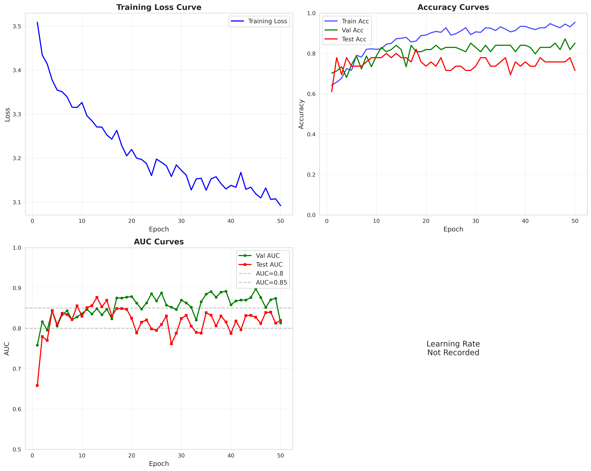
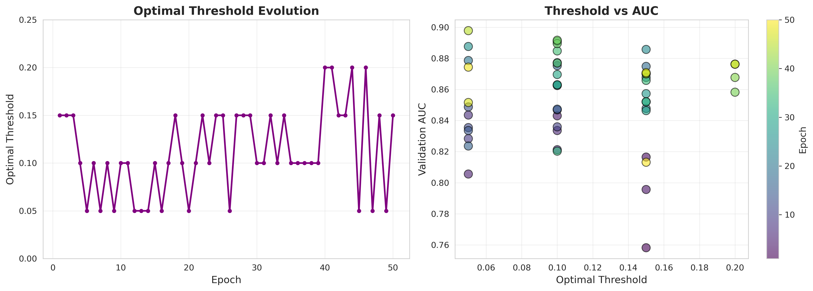

<div align="center">

# GCN-LLM-UniMol

**2D 图 · SMILES 语义 · 3D 构象 —— 三模态分子表示，面向单靶点虚拟筛选**

[](https://www.python.org/)
[](https://pytorch.org/)
[](https://pytorch-geometric.readthedocs.io/)
[](LICENSE)

`630` 个 XOD 分子 · 测试集 ROC-AUC `0.827` · 模型约 `0.19 M` 参数

</div>

---

## 目录

- [项目简介](#项目简介)
- [效果](#效果)
- [模型架构](#模型架构)
- [仓库结构](#仓库结构)
- [快速开始](#快速开始)
  - [1. 环境](#1-环境)
  - [2. 模型权重](#2-模型权重)
  - [3. 开跑](#3-开跑)
- [数据准备](#数据准备)
- [命令行参考](#命令行参考)
- [加载训练好的模型](#加载训练好的模型)
- [更严格的评估](#更严格的评估)
- [已知局限](#已知局限)
- [整理说明](#整理说明)
- [引用](#引用)
- [许可证](#许可证)
- [发布到 GitHub](#发布到-github)
- [English](#english)

---

## 项目简介

GCN-LLM-UniMol 把同一个分子的三种表示拼在一起，再与靶点蛋白做对比学习：

| 模态 | 来源 | 维度 | 捕捉的信息 |
|---|---|---|---|
| **2D 图结构** | RDKit → PyG `Data` | 节点特征 139 | 原子类型、度、电荷、杂化、芳香性、氢数 |
| **SMILES 语义** | ChemBERTa (`seyonec/ChemBERTa-zinc-base-v1`) | 768 | 序列层面的化学语义 |
| **3D 构象** | DrugCLIP / Uni-Mol | 512 | 空间几何与构象 |

三者分别投影到 64 维，在 **6 层 GCN 的每一层**都与节点表示拼接（64+64+64 = 192），
最后全局平均池化得到 **192 维分子表示**，用 **InfoNCE** 与蛋白嵌入对齐。

与"拼接一个大特征向量再回归"的做法相比，这里的多模态信息在每一层图卷积中都重新注入，
不会在深层 GCN 中被拓扑信息淹没。

**本仓库是一个可直接运行的完整实验包**：代码 + 已清洗的 XOD 数据 + 预计算嵌入 +
训练好的权重 + 训练报告，同时保留了对 DrugCLIP / Uni-Mol / ChemBERTa 的接入。

## 效果

在 XOD（Xanthine dehydrogenase/oxidase，PDB **3NVW**，ChEMBL 靶点 `CHEMBL1929`）的
630 个分子上，按 70/15/15 随机划分，训练 50 轮（第 45 轮取得最佳）：

| 指标 | 验证集 | 测试集 |
|---|---:|---:|
| **ROC-AUC** | **0.8978** | **0.8273** |
| Accuracy | 0.8298 | 0.7579 |
| F1 | 0.8689 | 0.7473 |
| 训练集 Accuracy | 0.9477 | — |

训练总耗时约 95 s，最佳分类阈值 0.050。

<div align="center">
  
  <br>
  <sub>训练 / 验证损失与 AUC 曲线</sub>
</div>

<div align="center">
  
  <br>
  <sub>分类阈值对 Accuracy / F1 / Precision / Recall 的影响</sub>
</div>

> ⚠️ 这组数字来自**随机划分**，同一系列的类似物会同时出现在训练与测试集，
> 指标偏乐观。用 `Final/upgrade/scaffold_split.py` 做骨架划分可以得到更诚实的估计，
> 详见[更严格的评估](#更严格的评估)。

## 模型架构

```
分子：三条支路
├─ 2D 图              139 维节点特征 ─────────────────┐
├─ ChemBERTa          768 ──[llm_proj]──► 64 ─────────┤  按分子广播到每个原子
└─ DrugCLIP / Uni-Mol 512 ──[unimol_proj]──► 64 ──────┘
                                                     │
                     ┌───────────────────────────────┘
                     ▼
      GCNConv × 6 ：第 1 层 139 → 64；第 2~6 层 192 → 64
      每层输出后再拼接  [ GCN(64) ‖ LLM(64) ‖ 3D(64) ] = 192
                     │
                     ▼
      global_mean_pool → 分子表示 [B, 192]
                     │
                     ▼
      InfoNCE  ⟷  蛋白表示（DrugCLIP 512 → 64 → 重复 3 次 = 192）
```

| 组件 | 配置 | 参数量 |
|---|---|---:|
| GCNConv × 6 + BatchNorm | 139→64，随后 192→64 | ≈ 71 K |
| LLM 投影 | 768 → 64 | ≈ 49 K |
| UniMol 投影 | 512 → 64 | ≈ 33 K |
| 分类头（可选） | 192 → 192 → 2 | ≈ 37 K |

训练细节：Adam（`lr=1e-3`，`weight_decay=1e-5`）、`ReduceLROnPlateau`（factor 0.5，
patience 10）、按验证 AUC 保存最佳模型、早停 patience 20、InfoNCE 温度 0.07（可学习）。

## 仓库结构

```
.
├── Final/                              # 模型主体
│   ├── gcn_llm_unimol_encoder.py       # 编码器 + 分类器（GCN×6 + 双投影）
│   ├── train.py                        # 训练主脚本（InfoNCE / 早停 / AUC 评估）
│   ├── prepare_complete_embeddings.py  # ChemBERTa(768) + DrugCLIP(512) 嵌入生成
│   ├── unimol_feature_extractor.py     # DrugCLIP 封装：3D 构象、口袋提取、PDB 下载
│   ├── chemberta_feature_extractor.py  # ChemBERTa 封装：768 维语义嵌入
│   ├── quick_start.py                  # 一键：嵌入 → 训练 → 绘图
│   ├── visualize.py                    # 训练曲线
│   ├── visualize_results.py            # 阈值分析 / 性能汇总 / 改进对比
│   ├── test_drugclip_loading.py        # DrugCLIP 权重加载自检
│   ├── upgrade/                        # A 方案扩展（见「更严格的评估」）
│   │   ├── element_tokenizer.py        #   元素级 tokenizer（对齐 dict_mol.txt）
│   │   ├── scaffold_split.py           #   Bemis-Murcko 骨架划分
│   │   └── vs_metrics.py               #   EF / BEDROC / ROC-AUC 等 VS 指标
│   ├── Data/                           # 数据管线：ChEMBL 下载 → 清洗
│   │   ├── 1_download_chembl_data.py
│   │   ├── 2_process_molecules.py
│   │   ├── run_all.py
│   │   ├── utils/                      # chembl_downloader / molecule_processor
│   │   └── output/processed_data.csv   # 已附带的 XOD 数据（630 分子）
│   ├── complete_embeddings/            # XOD 预计算嵌入 + 打包训练集
│   └── results_complete/               # 最佳训练结果（权重 / 曲线 / 报告）
│
├── DrugCLIP-main/                      # 外部代码：DrugCLIP / Uni-Mol（unimol 包 + 词表）
├── checkpoints/                        # DrugCLIP 权重（需自行下载）
├── models--seyonec--ChemBERTa-zinc-base-v1/   # ChemBERTa（分词器 + 权重）
│
├── requirements.txt
├── environment.yml                     # conda 环境（可选）
├── LICENSE
└── .gitignore
```

仓库体积约 **12 MB**（不含两个外部权重，约 1.3 GB）。

## 快速开始

### 1. 环境

```bash
conda create -n gcn-unimol python=3.10 -y
conda activate gcn-unimol

# PyTorch（按你的 CUDA 版本选择，下面以 cu118 为例）
pip install torch torchvision --index-url https://download.pytorch.org/whl/cu118

# 其余依赖
pip install -r requirements.txt

# PyG 的 C++ 扩展必须与 torch / CUDA 版本匹配
pip install torch-scatter torch-sparse torch-cluster torch-spline-conv \
    -f https://data.pyg.org/whl/torch-2.0.0+cu118.html

# DrugCLIP / Uni-Mol 的底层框架
pip install unicore
```

也可以用 conda 一次性建环境：`conda env create -f environment.yml`（内含 cpuonly 版本）。

> **unicore 是硬依赖**。没有它 DrugCLIP 无法加载，`unimol_feature_extractor` 会直接抛错，
> 不会悄悄用随机向量顶替。

### 2. 模型权重

仓库**不分发**两个大权重（超过 GitHub 100 MB 限制），但**已附带 XOD 的预计算嵌入**，
所以只想复现训练的话可以跳过本节。

| 权重 | 放置路径 | 大小 | SHA256 |
|---|---|---:|---|
| DrugCLIP | `checkpoints/drugclip.pt` | 1.10 GB | `DC2C76D0F02F9BB079A613F09D538DCDA1BF9075F2952D91DC1BEA55571F667E` |
| ChemBERTa | `models--seyonec--ChemBERTa-zinc-base-v1/snapshots/761d6a18.../pytorch_model.bin` | 170.5 MB | `BF8A23D93CCA196C3712C94EC379494A74BE64C83D86A63B08F03E26DB547267` |

**DrugCLIP**：从官方发布页下载 `checkpoint.pt`，重命名后放入 `checkpoints/`。

> https://drive.google.com/drive/folders/1zW1MGpgunynFxTKXC2Q4RgWxZmg6CInV

**ChemBERTa**：分词器与配置已在仓库内，补下权重即可。

```bash
pip install huggingface_hub
huggingface-cli download seyonec/ChemBERTa-zinc-base-v1 \
  --local-dir models--seyonec--ChemBERTa-zinc-base-v1/snapshots/761d6a18cf99db371e0b43baf3e2d21b3e865a20
```

如果想把权重放在别处，设置环境变量即可（代码优先读它）：

```bash
export CHEMBERTA_MODEL_PATH=/path/to/ChemBERTa-zinc-base-v1   # Windows: setx
```

自检：

```bash
python Final/test_drugclip_loading.py
# ✓ 模型加载成功: BindingAffinityModel
# ✓ 嵌入维度: (512,)
```

### 3. 开跑

**A. 只用已附带的嵌入训练（无需下载任何权重，最快）**

```bash
python Final/train.py \
    --data Final/complete_embeddings/training_data_complete.pkl \
    --epochs 50 --batch_size 32 --lr 1e-3 \
    --output results
```

产出 `results/best_model.pt`、`results/history.json`。

**B. 一键跑通「嵌入 → 训练 → 曲线」**

```bash
python Final/quick_start.py --pdb-id 3NVW
# 等价于：
#   prepare_complete_embeddings.py → train.py → visualize.py
```

加 `--skip-embed` 可复用 `Final/complete_embeddings/` 里已有的嵌入。

**C. 画图**

```bash
python Final/visualize.py --history results/history.json --output results/training_plot.png
python Final/visualize_results.py --history results/history.json --output results
```

## 数据准备

仓库自带的 XOD 数据已经在 `Final/Data/output/processed_data.csv`。换靶点时：

```bash
# 1) 从 ChEMBL 下载并清洗（输出到 Final/Data/output/）
python Final/Data/run_all.py --target "Xanthine dehydrogenase/oxidase" \
    --similarity 0.85 --max_compounds 5000

# 2) 生成 ChemBERTa(768) + DrugCLIP(512) 嵌入
python Final/prepare_complete_embeddings.py \
    --data Final/Data/output/processed_data.csv \
    --drugclip-checkpoint checkpoints/drugclip.pt \
    --pdb-id 3NVW \
    --output Final/complete_embeddings

# 3) 训练
python Final/train.py --data Final/complete_embeddings/training_data_complete.pkl --output results
```

`processed_data.csv` 的 18 列含义见 [`Final/Data/README.md`](Final/Data/README.md)。

## 命令行参考

**`Final/train.py`**

| 参数 | 默认 | 说明 |
|---|---|---|
| `--data` | 必填 | `.pkl`（含 `smiles/labels/unimol_embeddings/chemberta_embeddings/protein_embedding`）、`.csv` 或 `.txt` |
| `--unimol-emb` | — | 覆盖 pkl 中的 UniMol 嵌入（`.pkl`，`{smiles: vector}`） |
| `--protein-emb` | — | 覆盖蛋白嵌入（`.npy`，512 维） |
| `--epochs` | 100 | 最大轮数（早停 patience 20） |
| `--batch_size` | 32 | 批次大小 |
| `--lr` | 1e-3 | 初始学习率 |
| `--temperature` | 0.07 | InfoNCE 温度 |
| `--learnable_temp` | off | 温度作为可学习参数 |
| `--output` | `output` | 输出目录 |

**`Final/prepare_complete_embeddings.py`**

| 参数 | 默认 | 说明 |
|---|---|---|
| `--data` | 必填 | 清洗后的 CSV |
| `--drugclip-checkpoint` | 必填 | DrugCLIP 权重路径 |
| `--pdb-id` | 必填 | 靶点 PDB ID（自动下载） |
| `--chemberta-model` | 包内路径 / `CHEMBERTA_MODEL_PATH` | ChemBERTa 目录 |
| `--output` | `complete_embeddings` | 输出目录 |
| `--device` | `cuda` | 无 GPU 时自动降级为 `cpu` |
| `--batch-size` | 32 | ChemBERTa 批次大小 |
| `--max-pocket-atoms` | 512 | 蛋白口袋截断原子数 |

**`Final/quick_start.py`**：`--pdb-id`（必填）、`--checkpoint`、`--data`、`--emb-dir`、
`--epochs`、`--batch-size`、`--lr`、`--device`、`--output`、`--skip-embed`。

## 加载训练好的模型

```python
import torch
from gcn_llm_unimol_encoder import GCN_LLM_UniMol_Classifier   # 需要把 Final/ 加入 sys.path
from train import smiles_to_graph

model = GCN_LLM_UniMol_Classifier(
    num_node_features=139, num_classes=2,
    hidden_channels=64, llm_dim=768, unimol_dim=512,
    proj_dim=64, num_gcn_layers=6, dropout=0.2,
)
ckpt = torch.load("Final/results_complete/best_model.pt", map_location="cpu")
model.load_state_dict(ckpt["model_state_dict"])
model.eval()

graph = smiles_to_graph("CCO")
batch = torch.zeros(graph.num_nodes, dtype=torch.long)

llm_emb = torch.zeros(1, 768)     # 换成 ChemBERTa 的真实嵌入
unimol_emb = torch.zeros(1, 512)  # 换成 DrugCLIP 的真实嵌入

with torch.no_grad():
    logits = model(graph.x, graph.edge_index, batch, llm_emb, unimol_emb)
    prob = logits.softmax(dim=-1)[0, 1].item()
print(f"活性概率: {prob:.4f}")
```

`best_model.pt` 里还保存了训练时的 `protein_proj_state_dict`（仅用于对比学习，推理不需要）。

## 更严格的评估

`Final/upgrade/` 收录了三个可选工具，用来回答"这个 0.827 到底有多少水分"：

```bash
# 1) Bemis-Murcko 骨架划分，避免类似物泄漏
python Final/upgrade/scaffold_split.py \
    --input Final/Data/output/processed_data.csv \
    --smiles-col smiles --label-col label \
    --ratios 0.8 0.1 0.1 --seed 42 \
    --out-dir Final/Data/output/splits_scaffold

# 2) 虚拟筛选指标：EF1% / EF5% / BEDROC / ROC-AUC
python Final/upgrade/vs_metrics.py --selftest

# 3) 元素级 tokenizer（与 dict_mol.txt 的 token 对齐）
python Final/upgrade/element_tokenizer.py --dict DrugCLIP-main/data/dict_mol.txt
```

## 已知局限

1. **随机划分偏乐观**：630 个分子来自同一靶点的同系物系列，测试集里可能有训练集的近邻。
   请用骨架划分复核（见上节）。
2. **单靶点专用**：模型是"一个蛋白一个模型"，没有零样本迁移能力。
3. **数据规模小**：验证/测试各约 95 个分子，AUC 波动 ±0.03 属正常。
4. **蛋白词表是精简版**：`DrugCLIP-main/data/dict_pkt.txt` 只有 `C N O S H` 五种元素 +
   4 个特殊 token，与上游完整词表不同；若要严格复现 DrugCLIP 官方结果，需替换词表并重新提取蛋白嵌入。
5. **权重部分加载**：`BindingAffinityModel` 以 `strict=False` 加载 DrugCLIP 权重，
   部分层可能随机初始化（加载时会打印 missing keys），这是为了适配 512 维输出所做的取舍。
6. **没有独立的推理脚本**：见上一节代码片段。

## 整理说明

本仓库由原始实验工程整理而来，主要做了三类改动：

**删除**（与当前模型无关或纯粹重复）

- `Data/3_extract_features.py`、`Data/4_create_dataset.py`、`utils/feature_extractor.py`——
  早期管线的特征/数据集构建，其 LLM 与 3D 嵌入是 `np.random.randn` 占位，容易误导；
- `prepare_unimol_data.py`——只提取 DrugCLIP 嵌入、LLM 侧同样走随机占位，
  已被 `prepare_complete_embeddings.py` 完全取代；
- `train_xod_example.py/.sh/.bat`——与 `train.py` 重复的演示脚本，默认路径指向仓库外；
- 三组次优训练结果（`output/`、`results/`、`results_v3/`）、重复的 `.pkl` 中间文件、
  `__pycache__`、`.ipynb_checkpoints`、词表 `.bak`、上游训练脚本等。

**修复**

- `chemberta_feature_extractor.py`：硬编码的绝对路径改为「环境变量 → 仓库相对路径」，
  并去掉 `assert torch.cuda.is_available()`（纯 CPU 机器导入即崩）；
- `prepare_complete_embeddings.py`：`--chemberta-model` 改为可选，默认用仓库内模型；
- `quick_start.py` / `Data/run_all.py` / `test_drugclip_loading.py`：重写为与路径无关，
  可从任意目录执行；Quick Start 改为走真实的 ChemBERTa + DrugCLIP 流程；
- `unimol_feature_extractor.py`：`device` 在无 GPU 时自动降级为 `cpu`。

**保留**：`DrugCLIP-main/`（unimol 包与词表）、`Final/results_complete/`、XOD 数据与预计算嵌入。

## 引用

如果这个仓库对你有帮助，请引用它依赖的上游工作：

```bibtex
@article{gao2023drugclip,
  title   = {DrugCLIP: Contrastive Protein-Molecule Representation Learning for Virtual Screening},
  author  = {Gao, Bowen and others},
  journal = {Advances in Neural Information Processing Systems},
  year    = {2023}
}

@inproceedings{zhou2023unimol,
  title     = {Uni-Mol: A Universal 3D Molecular Representation Learning Framework},
  author    = {Zhou, Gengmo and Gao, Zhifeng and Ding, Qiankun and others},
  booktitle = {International Conference on Learning Representations},
  year      = {2023}
}

@article{chithrananda2020chemberta,
  title   = {ChemBERTa: Large-Scale Self-Supervised Pretraining for Molecular Property Prediction},
  author  = {Chithrananda, Seyone and Grand, Gabriel and Ramsundar, Bharath},
  journal = {arXiv preprint arXiv:2010.09885},
  year    = {2020}
}
```

## 许可证

本项目代码采用 [MIT License](LICENSE)。
`DrugCLIP-main/`、ChemBERTa 权重及 PyTorch Geometric 等第三方组件的版权与许可归各自作者所有，
使用前请阅读 `DrugCLIP-main/LICENSE` 与对应模型卡。

## 发布到 GitHub

```bash
git init
git add .
git commit -m "feat: GCN-LLM-UniMol 三模态分子表示与虚拟筛选"
git branch -M main
git remote add origin https://github.com/<your-name>/GCN-LLM-UniMol.git
git push -u origin main
```

`.gitignore` 已排除两个大权重，正常推送不会触发 GitHub 的 100 MB 限制。

---

## English

**GCN-LLM-UniMol** learns a 192-d molecule representation by fusing three modalities —
a 2D molecular graph (6-layer GCN), ChemBERTa SMILES semantics (768-d) and DrugCLIP /
Uni-Mol 3D conformer features (512-d) — re-injecting the two global vectors at every GCN
layer, and aligns molecules with a target protein via InfoNCE.

This repository is a self-contained experiment package: code, a cleaned XOD dataset
(630 molecules, PDB 3NVW), precomputed embeddings, the trained checkpoint and its report.
On a random split it reaches **0.8978 / 0.8273 ROC-AUC** on validation / test; see
[更严格的评估](#更严格的评估) for the caveat and a scaffold-split alternative.

Quick start (no model weights required):

```bash
pip install -r requirements.txt
python Final/train.py --data Final/complete_embeddings/training_data_complete.pkl --epochs 50 --output results
```

Model weights (DrugCLIP 1.1 GB, ChemBERTa 170 MB) are not distributed here; download
instructions are in [模型权重](#2-模型权重). Licensed under MIT.
